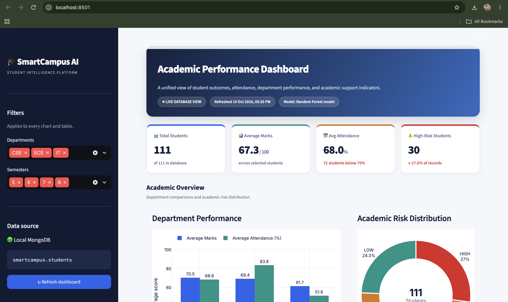

# SmartCampus AI

**Student performance and academic risk analytics on MongoDB, Python and Streamlit.**


SmartCampus AI stores student records in MongoDB, analyzes department-level performance with aggregation pipelines and Pandas, flags students who may need academic support with a Random Forest classifier, and presents everything in an interactive Streamlit dashboard.

> **Note:** All student data in this project is synthetic. See [Limitations](#limitations) before drawing any conclusions from the model output.



---

## Table of Contents

- [Features](#features)
- [Architecture](#architecture)
- [Tech Stack](#tech-stack)
- [Database Design](#database-design)
- [MongoDB Concepts Demonstrated](#mongodb-concepts-demonstrated)
- [Machine Learning Methodology](#machine-learning-methodology)
- [Dashboard](#dashboard)
- [Getting Started](#getting-started)
- [Configuration](#configuration)
- [Project Structure](#project-structure)
- [Troubleshooting](#troubleshooting)
- [Limitations](#limitations)
- [Future Improvements](#future-improvements)
- [Author](#author)

---

## Features

- **Student data management:** insert, query, update and delete student records through MongoDB CRUD operations.
- **Schema validation:** JSON Schema validator enforcing required fields and a 0–100 range for attendance and marks.
- **Indexing:** single-field, compound and text indexes for common queries.
- **Aggregation:** department-wise student counts, average attendance and average marks using `$group`, `$match`, `$project`, `$avg`, `$sum` and `$sort`.
- **Data modeling:** embedded documents, referenced documents and cross-collection queries with `$lookup`.
- **Risk classification:** a Random Forest model labels each student `HIGH`, `MEDIUM` or `LOW` risk, with a transparent rule-based fallback.
- **Interactive dashboard:** KPI cards, department comparisons, risk distribution, filterable student records, individual student profiles and CSV export.

## Architecture

```text
Student Records
      |
      v
   MongoDB
      |
      v
    PyMongo
      |
      v
 Python + Pandas
      |
      +--------------------+
      |                    |
      v                    v
 Random Forest       Department Analytics
      |                    |
      +----------+---------+
                 |
                 v
         Streamlit Dashboard
```

## Tech Stack

| Technology | Purpose |
|---|---|
| MongoDB | NoSQL document database |
| PyMongo | Python–MongoDB integration |
| Python | Application logic and data processing |
| Pandas | Tabular data analysis |
| scikit-learn | Random Forest classification |
| Plotly | Interactive charts |
| Streamlit | Web dashboard |

## Database Design

The `smartcampus` database has three collections.

### `students`

| Field | Description |
|---|---|
| `studentId` | Unique student identifier (e.g. `CSE101`) |
| `name` | Student name |
| `department` | Department code |
| `semester` | Current semester |
| `attendance` | Attendance percentage (0–100) |
| `averageMarks` | Average marks (0–100) |
| `assignmentsCompleted` | Number of assignments completed |
| `academicProfile` | Embedded academic information (selected records) |

Example document:

```javascript
{
  studentId: "CSE101",
  name: "Rahul Sharma",
  department: "CSE",
  semester: 6,
  attendance: 85,
  averageMarks: 78
}
```

### `courses`

Course ID, course name, department and credits.

### `enrollments`

Links students to courses through `studentId` and `courseId`. The `$lookup` stage joins enrollments, students and courses for reporting.

## MongoDB Concepts Demonstrated

| Concept | Implementation |
|---|---|
| CRUD operations | Insert, find, update and delete student records |
| Querying | Filter students by attendance and other fields |
| Schema validation | JSON Schema validator |
| Single-field index | `studentId` |
| Compound index | `department` + `semester` |
| Text index | Student name search |
| Aggregation | `$group`, `$match`, `$project`, `$avg`, `$sum`, `$sort` |
| Embedding | `academicProfile` inside a student document |
| Referencing | `studentId` and `courseId` in enrollments |
| Cross-collection query | `$lookup` |

## Machine Learning Methodology

A Random Forest classifier predicts one of three academic risk levels from two features: **attendance** and **average marks**.

Training labels are generated from explicit thresholds:

| Risk level | Rule |
|---|---|
| `HIGH` | Attendance < 75% **and** average marks < 60 |
| `MEDIUM` | Attendance < 75% **or** average marks < 60 |
| `LOW` | Neither condition is met |

`train_model.py` loads records from MongoDB, applies the same cleaning as the dashboard, and then:

1. Evaluates on a 25% stratified hold-out set (classification report and confusion matrix).
2. Runs k-fold cross-validation when every class has enough records.
3. Prints feature importances.
4. Refits the final model on all records and compares it with the rule on every record.
5. Checks edge cases around the thresholds.
6. Saves `risk_model.pkl` containing the model, feature order, thresholds and training metadata.

If `risk_model.pkl` is missing or cannot be loaded, the dashboard falls back to the same rules and states this in the footer and hero banner.

`assignmentsCompleted` is stored and displayed but is not a model feature, because the labels do not depend on it.

## Dashboard

**Sidebar**
- Global department and semester filters that drive every chart and table
- Data source indicator and a refresh button that clears the cache

**Header and KPIs**
- Total students, average marks, average attendance and high-risk count
- Model source shown in the header (Random Forest or rule-based fallback)

**Overview charts**
- Department performance: average marks and attendance side by side
- Academic risk distribution donut

**Tabs**
- **Overview:** students requiring attention, sorted by risk and marks, with colour-coded risk labels
- **Student Directory:** search by ID or name, risk filter, CSV download and a single-student profile compared against the department average
- **Academic Insights:** attendance vs marks scatter with 75% / 60 reference lines, marks by semester, risk mix by department, marks distribution and a department summary table
- **Data Explorer:** record, field and department counts, raw data table and full dataset export

## Getting Started

### Prerequisites

- Python 3.10 or newer
- MongoDB Community Server
- A code editor such as VS Code

### 1. Clone the repository

```bash
git clone <github.com/Qaleelsha/SmartCampus-AI.git>
cd SmartCampus-AI
```

### 2. Create a virtual environment

```bash
python3 -m venv .venv
source .venv/bin/activate        # Windows: .venv\Scripts\activate
```

### 3. Install dependencies

```bash
python -m pip install --upgrade pip
python -m pip install pymongo streamlit pandas plotly scikit-learn
```

### 4. Start MongoDB and load the data

Make sure MongoDB is running, then check the connection:

```bash
mongosh "mongodb://127.0.0.1:27017"
```

```javascript
use smartcampus
```

The application expects the `students` collection to be populated (111 synthetic records in the reference setup). Load the project data using your database setup scripts before launching the dashboard.

### 5. Train the model

```bash
python train_model.py
```

This creates `risk_model.pkl` in the project directory. Re-run it whenever the data or the thresholds change.

### 6. Launch the dashboard

```bash
python -m streamlit run app.py
```

Open [http://localhost:8501](http://localhost:8501).

## Configuration

| Setting | Default | Description |
|---|---|---|
| `MONGO_URI` | `mongodb://127.0.0.1:27017` | MongoDB connection string, read from the environment by both `app.py` and `train_model.py` |

Example:

```bash
export MONGO_URI="mongodb://127.0.0.1:27017"
```

The dashboard uses a light theme defined in `.streamlit/config.toml`:

```toml
[theme]
base = "light"
primaryColor = "#2563EB"
backgroundColor = "#F5F7FB"
secondaryBackgroundColor = "#FFFFFF"
textColor = "#14213D"
font = "sans serif"
```

## Project Structure

```text
SmartCampus-AI/
├── .streamlit/
│   └── config.toml      # Light theme
├── docs/
│   └── dashboard.png    # Screenshot used in this README
├── app.py               # Streamlit dashboard
├── train_model.py       # Model training and evaluation
├── risk_model.pkl       # Generated by train_model.py
├── README.md
└── .venv/               # Local environment (do not commit)
```

Add `.venv/` and `__pycache__/` to `.gitignore`. `risk_model.pkl` can be regenerated at any time.

## Troubleshooting

| Problem | Fix |
|---|---|
| "Unable to connect to MongoDB" | Start the MongoDB service and check `MONGO_URI`. |
| Footer says "Rule-based fallback" | Run `python train_model.py` in the same virtual environment used for Streamlit. A model saved under a different scikit-learn version may fail to load. |
| Charts or tables render dark | Make sure `.streamlit/config.toml` is in the folder you launch Streamlit from. |
| Unexpected risk labels | Retrain the model, then check the edge-case table printed by `train_model.py`. |

## Limitations

- The dataset is synthetic and does not represent real students.
- Training labels are generated from fixed thresholds, so the classifier learns a known rule.
- Reported accuracy measures agreement with those generated labels, not the ability to predict real academic outcomes, and it is expected to be close to 100%.
- The model has not been validated on real or independently labelled data.
- Risk levels are support indicators only. Review individual records before making any academic decision.

## Future Improvements

- Student registration and record-update interface
- Larger, more representative dataset
- Evaluation against independently collected labels
- Course-wise performance and semester comparison reports
- Authentication and role-based access
- Automated tests and a `requirements.txt` with pinned versions

## Author

**Qaleel Sha Backer**
B.Tech CSE (Data Science and Machine Learning), Lovely Professional University

[GitHub](https://github.com/Qaleelsha) · [LinkedIn](https://linkedin.com/in/qaleel-sha-backer) · [Portfolio](https://qaleelshabacker.netlify.app)

Built as an Intelligent NoSQL Databases mini-project.